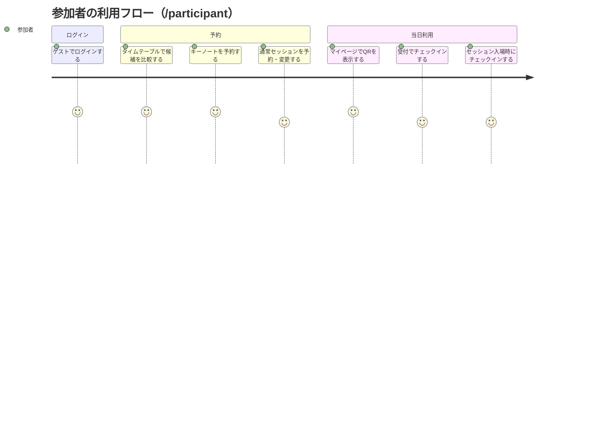
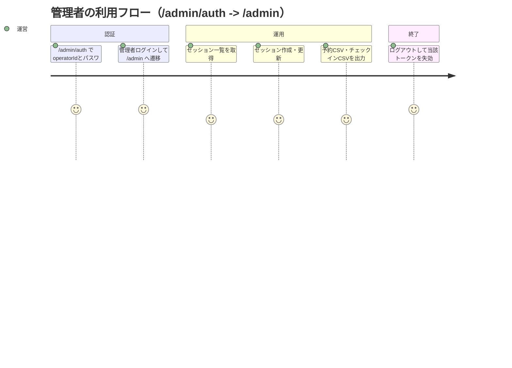
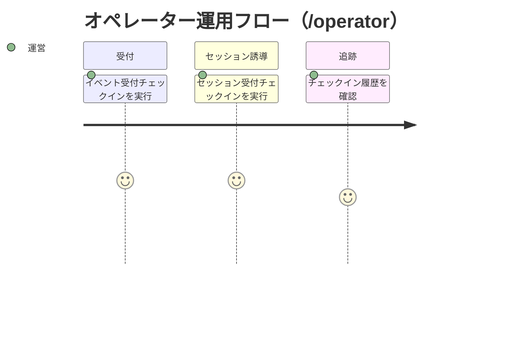

# ユーザージャーニー（2026-02-23時点）

## 1. 参加者（ゲスト）

## 2. 管理者（運営）

## 3. オペレーター（現場運用）

## 4. 主要タッチポイント

- 参加者UI: `/participant`
- 管理UI: `/admin/auth`, `/admin`
- 運用UI: `/operator`
- API: 認証、予約、管理、チェックイン、エクスポート
