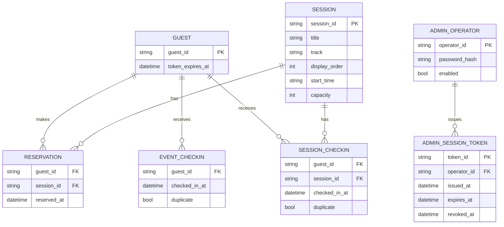

# ER図（論理モデル / 2026-02-23時点）

実装はインメモリ主体ですが、業務的な関係を論理モデルとして整理します。

## 制約

- `RESERVATION`: `(guest_id, session_id)` はユニーク
- 同時刻 `SESSION` に対して同一 `guest_id` の複数予約は禁止
- `SESSION.capacity` を超える予約は禁止
- チェックインは同一対象で重複時に `duplicate=true`
- 管理者APIは有効な `ADMIN_SESSION_TOKEN` が必要
