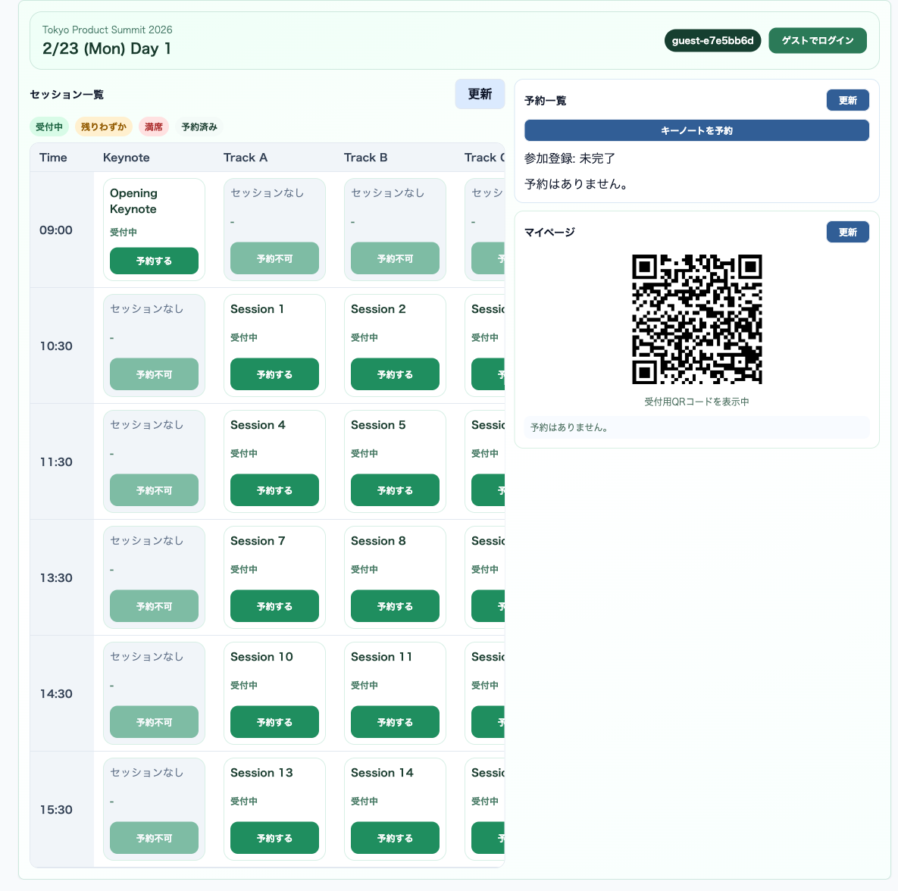
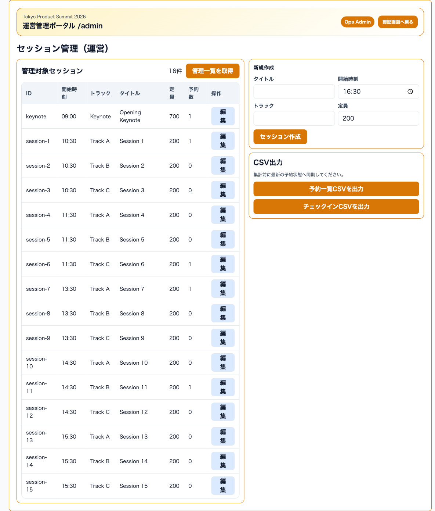
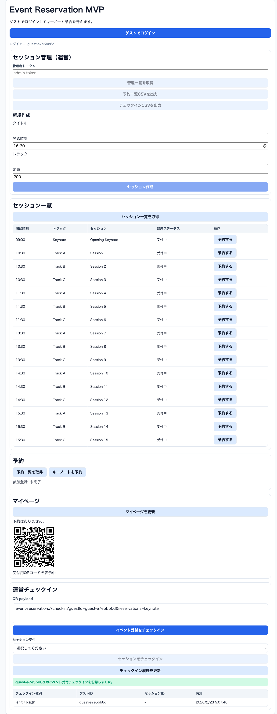

# 操作マニュアル（2026-02-23更新）

Playwright MCPで Participant/Admin/Operator の主要動線を実機確認し、スクリーンショットを更新しています。

## 1. 参加者向け（`/participant`）

### 1.1 ログインと画面確認

1. `http://127.0.0.1:5173/participant` を開く
2. `ゲストでログイン` を押下する
3. 画面上部に `guest-xxxxxxx` が表示されることを確認する
4. タイムテーブル、予約一覧、マイページ（QR表示）が表示されることを確認する

### 1.2 キーノート予約

1. 右カラムの `キーノートを予約` を押下
2. `参加登録` が完了状態になることを確認

### 1.3 通常セッション予約

1. タイムテーブルの対象セッションで `予約する` を押下
2. 予約済み表示に切り替わることを確認
3. 競合時間帯・上限超過時はエラーメッセージを確認

### 1.4 マイページ・QR

1. `マイページ` の `更新` を押下
2. 予約一覧が表示されることを確認
3. `受付用QRコード` が表示されることを確認

## 2. 管理者向け（`/admin/auth` -> `/admin`）

### 2.1 ログイン

1. `http://127.0.0.1:5173/admin/auth` を開く
2. `運用者ID（operatorId）` と `パスワード` を入力する
3. `ログインして管理画面へ進む` を押下
4. `/admin` で管理画面が表示されることを確認

### 2.2 セッション管理

1. `管理一覧を取得` を押下
2. セッション一覧（ID/開始時刻/トラック/タイトル/定員/予約数）を確認
3. 必要に応じて `編集` または `新規作成` を実行

### 2.3 CSV出力

1. `予約一覧CSVを出力` を押下して `reservations.csv` を保存
2. `チェックインCSVを出力` を押下して `session-checkins.csv` を保存

## 3. オペレーター向け（`/operator`）

### 3.1 チェックイン実行

1. `http://127.0.0.1:5173/operator` を開く
2. `QR payload` 欄に参加者QR payloadを入力
3. イベント受付は `イベント受付をチェックイン` を押下
4. セッション受付は対象セッション選択後 `セッションをチェックイン` を押下
5. `チェックイン履歴を更新` で記録を確認

### 3.2 動作確認例（2026-02-23）

- 入力例: `event-reservation://checkin?guestId=guest-e7e5bb6d&reservations=keynote`
- 結果: `guest-e7e5bb6d のイベント受付チェックインを記録しました。`

## 4. 代表エラーと対処

| メッセージ | 原因 | 対処 |
| --- | --- | --- |
| 同じ時間帯のセッションは1つまでしか予約できません。 | 同時刻セッションを重複予約しようとした | 既存予約を確認し別時間帯を選択 |
| 通常セッションは最大5件までしか予約できません。 | 通常セッション上限超過 | 不要な予約をキャンセル後に再予約 |
| このセッションは開始30分前を過ぎたため予約できません。 | 締切超過 | 運営へ当日案内を確認 |
| 現在の予約数を下回る定員には変更できません。 | 管理更新時に定員を下げすぎ | 予約数以上の定員を設定 |
| このQRコードでは対象セッションをチェックインできません。 | QR内予約と受付セッションが不一致 | 正しいQR/セッションを選択 |
